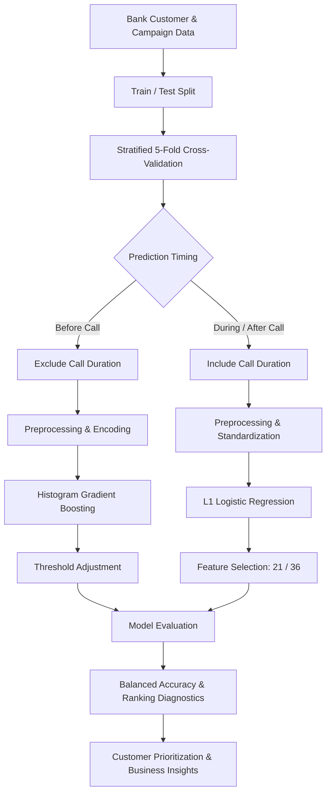

# Term Deposit Subscription Prediction | FinTech & Machine Learning

**Python · Scikit-learn · L1 Logistic Regression · Gradient Boosting · Feature Selection · Cross-Validation**

A machine learning system developed for banking marketing analytics, predicting customer term-deposit subscriptions to improve campaign targeting and call-centre efficiency. Combines interpretable statistical models, ensemble learning, and feature selection to identify prospective customers while accounting for severe class imbalance.

## Project Overview

**The Problem**

Bank marketing campaigns involve contacting large numbers of customers, most of whom do not subscribe to the advertised product. With approximately 93% non-subscribers in the dataset, conventional accuracy metrics can create misleading impressions of predictive performance.

Furthermore, the strongest predictor of subscription—call duration—is unavailable before contacting a customer, creating an important distinction between predictive accuracy and practical usability.

**The Solution**

I developed and evaluated multiple classification approaches, focusing on three components:

- **Predictive Modeling:** Compared L1-regularized logistic regression, histogram gradient boosting, and random forest classifiers to identify customers likely to subscribe.
- **Feature Engineering & Interpretability:** Applied one-hot encoding, class weighting, and L1 regularization, reducing the logistic regression feature set from 36 to 21 predictors while maintaining strong classification performance.
- **Business-Oriented Evaluation:** Used stratified cross-validation, balanced accuracy, threshold adjustment, and customer-segment analysis to evaluate models according to their practical banking applications.

## Evaluation Results

Models were evaluated using stratified five-fold cross-validation, with separate comparisons for predictions made before and during/after customer calls.

| Model | Call Duration Included? | Balanced Accuracy | Accuracy |
|---|---|---:|---:|
| L1 Logistic Regression | Yes | **85.23% ± 0.55%** | 86.50% ± 0.43% |
| Histogram Gradient Boosting | No | **65.66% ± 1.13%** | 76.77% ± 0.55% |
| Random Forest | No | 63.00% ± 0.74% | 86.92% ± 0.69% |

**Key Findings:**

- **42% Feature Reduction:** L1 regularization retained 21 of 36 encoded features while preserving approximately 85% balanced accuracy.
- **Operational Prediction:** Histogram gradient boosting achieved the strongest reported pre-call balanced accuracy (65.66%) using information available before customer contact.
- **Business Insights:** Exploratory segment analysis identified higher subscription rates among selected customer groups, including an observed 2.29× subscription-rate lift for April contacts.

**Interpretation:** Call duration substantially improves classification performance but cannot be used for pre-call prospect selection. Pre-call models offer more modest predictive performance and are best suited to supporting customer prioritization rather than making definitive subscription predictions.

The reported metrics are cross-validation results, not independent future-campaign performance. Segment-level findings are observational and require further validation before operational use.

## System Architecture

The pipeline separates pre-call customer prioritization from during/post-call subscription prediction, ensuring that each model uses features available at its intended decision point.

## Technical Stack

| Component | Technologies |
|---|---|
| Development | Python, pandas, NumPy |
| Machine Learning | Scikit-learn, L1 Logistic Regression, Histogram Gradient Boosting, Random Forest |
| Feature Engineering | One-hot encoding, standardization, L1 regularization |
| Evaluation | Stratified 5-fold CV, balanced accuracy, precision, recall, F1, ROC AUC |
| Business Analytics | Customer segmentation, subscription-rate lift, threshold optimization |

---

## Data

The dataset contains customer characteristics and campaign information from a European banking institution. The target variable, y, records whether the customer subscribed to a term deposit.

The available predictors are age, job, marital status, education, credit default status, average yearly balance, housing-loan status, personal-loan status, contact method, contact day, contact month, call duration, and the number of campaign contacts.

Personal identifiers were removed from the data.

## Exploratory Data Analysis

No missing values were identified. The categorical variables were consistently reported, and the binary variables used clear yes-or-no values. Numeric variables were stored as integers.

The most important data issue was the severe class imbalance. There were approximately 205 non-buyers for every 16 buyers, meaning that roughly 93% of customers did not subscribe.

Because of this imbalance, ordinary accuracy can be misleading. A model can achieve more than 90% accuracy by predicting almost everyone as a non-buyer while still failing to identify actual buyers. Balanced accuracy, recall, precision, F1 score, ROC AUC, and log loss were therefore considered alongside raw accuracy.

## Data Preparation

Binary yes-or-no variables were converted to 0 and 1. Categorical variables with more than two categories were transformed using one-hot encoding, with one reference category removed from each variable.

The data was divided into an 80% training set and a 20% test set. Model development and comparison were performed on the training data using stratified five-fold cross-validation, which preserved the buyer-to-non-buyer ratio within each fold.

Standardization was performed inside the modelling pipeline so that the scaling parameters were learned separately within each training fold.

## Model Development

An L1-regularized logistic regression model was used to combine prediction with feature selection. Class weights were balanced so that errors involving the minority buyer class received greater importance.

The regularization value was selected to reduce the number of encoded inputs while preserving most of the predictive performance. The selected model used 21 encoded features instead of 36.

Across the reported runs, the reduced model achieved approximately 84% balanced accuracy, compared with approximately 84% for the larger model. One reported run also produced approximately 82% recall, showing that the model identified a large majority of the buyers.

The small performance reduction was considered acceptable because the reduced model was simpler and more interpretable.

## Accuracy Requirement

The requested success criterion was at least 81% average accuracy under five-fold cross-validation. The models can exceed this raw-accuracy target, but raw accuracy alone is not a reliable measure for this dataset.

For example, an unbalanced logistic regression model without call duration achieved approximately 93% accuracy but only 52% balanced accuracy. This means that its high accuracy came mainly from correctly predicting the much larger non-buyer group.

For this reason, balanced accuracy is the primary model-selection measure in this project.

## What Makes Customers Buy

The strongest predictive feature was call duration. Longer calls contain substantial information about whether the customer will subscribe. However, duration is only known during or after the call, so it cannot be used reliably to decide which customers should be contacted before a campaign begins.

The L1 feature-selection path suggested the following broad order of predictive contribution: duration first, followed by contact month and contact method, then housing-loan status, job, and marital status. Education, personal-loan status, balance, campaign contacts, contact day, credit default status, and age generally entered later and supplied smaller incremental improvements.

This order should be interpreted as a description of how the regularized model retained predictive information, not as proof that the earlier variables cause customers to buy.

When duration was removed, balanced logistic regression achieved approximately 61% balanced accuracy. Histogram gradient boosting improved this to approximately 65% after threshold adjustment. Random forest, elastic-net logistic regression, and other tested approaches produced similar or weaker results.

Adding pairwise interaction terms greatly increased model complexity, producing approximately 79 selected terms, but did not create a meaningful performance improvement. This suggests that the available pre-call variables contain only moderate predictive information.

The main practical conclusion is that duration explains much of the model's strongest performance, while the remaining customer and campaign variables are more useful for broad prioritization than highly accurate individual prediction.

## Priority Customer Segments

The segment analysis compared each group's purchase rate with the overall purchase rate. A lift above 1 indicates that a segment purchased more frequently than the average customer.

Students had approximately twice the average purchase rate, while retired customers had approximately 1.45 times the average rate. Management customers were only slightly above average but represented a large customer group, making them commercially relevant.

Single customers had a higher purchase rate than married customers, with an observed lift of approximately 1.5. Customers with tertiary education had a lift of approximately 1.26.

Customers aged 21 to 25 had an observed lift of approximately 1.86, and customers aged 26 to 30 had a lift of approximately 1.33. The broader 21-to-35 group generally performed above average.

Contact month was an important campaign variable. Customers contacted in April had an observed lift of approximately 2.29, while customers contacted in February had a lift of approximately 1.53. January and August were among the weakest months in the analysis.

Customers were most responsive during the earlier campaign contacts. Performance declined after repeated attempts, and customers contacted six or more times had an observed lift of approximately 0.77. This supports limiting repeated contacts when the expected return becomes small.

Several combined segments had especially high observed purchase rates. Management customers contacted in April had approximately 3.15 times the average purchase rate. Customers without a housing loan who were contacted in April had an observed lift of approximately 5.4. In contrast, married customers contacted in January had an observed lift of approximately 0.20.

These bivariate results should be treated cautiously because they are observational and may reflect month, campaign design, sample composition, or other correlated factors.

## Recommended Prioritization Strategy

For campaign planning, the client should initially give greater consideration to students, retired customers, single customers, customers with tertiary education, customers aged approximately 21 to 35, and customers scheduled for contact in April or February.

Management customers are also worth considering because their slightly above-average response rate is combined with a large available population. Management customers contacted in April were one of the strongest observed combined segments.

Repeated contact should be limited. The data suggests that campaigns should generally avoid exceeding five attempts unless there is another strong reason to continue.

Housing-loan status should not be used as a universal rule because its effect changed across segments. The strongest related result was specifically for customers without a housing loan who were contacted in April.

Any use of age, marital status, education, or financial attributes should be reviewed for fairness, business appropriateness, and applicable banking requirements before deployment.

## Final Model Recommendation

The appropriate model depends on when the prediction is required.

For analysis during or after a call, the reduced L1 logistic regression model with duration provides the strongest combination of balanced accuracy and interpretability. It retains 21 encoded features and achieves approximately 85.23% +/- 0.55% balanced accuracy. It has a raw accuracy of roughly 86.50% +/- 0.43% as an average score across the 5-fold cross-validation.

For selecting customers before calls are made, duration must be excluded. The best tested pre-call model was the histogram gradient boosting classifier with a decision threshold near 0.08, which achieved approximately 65.66% +/- 1.13% balanced accuracy. The low threshold reflects the rarity of buyers and the objective of improving minority-class detection; it is not evidence that the probabilities themselves are unusually strong. Following cross-validation, it has roughly a 76.77% +/- 0.55% raw accuracy.

If accuracy is to be prioritized, the forest model without duration has a raw accuracy of approximately 86.92% +/- 0.69% following 5-fold cross validation. Its balanced accuracy is approximately 63.00% +/- 0.74%.

The pre-call model should therefore be used as a ranking or prioritization aid rather than as a definitive decision system. Its threshold should be selected according to campaign capacity, contact cost, and the relative cost of missing a potential buyer.

## Conclusion

The project demonstrates that the subscription outcome can be predicted with strong balanced accuracy when call duration is included. However, much of this performance comes from information that is unavailable before the call.

Pre-call customer information provides only moderate predictive power, even after testing regularized logistic regression, nonlinear models, threshold adjustment, and interaction terms. The most defensible business use is therefore a combination of interpretable segment analysis and probability-based customer ranking.

The client should prioritize higher-lift segments, particularly customers contacted in April or February, younger adult customers, students, retired customers, single customers, and selected management customers. These findings should be validated on future campaigns before being treated as stable targeting rules.
